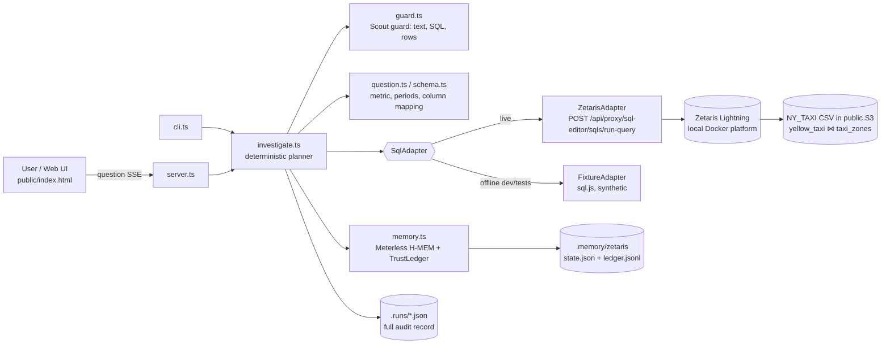

# Why Agent — an agent that can explain *why*

**Track:** The Agent That Can Explain Why · **Sponsor tech:** Zetaris (federated SQL) + Meterless (H-MEM memory, Scout guard spec)

Ask a business question like *"Why did average tips change between December 2024 and January 2025?"*.
The agent plans the SQL, runs it on a **real Zetaris Lightning instance** over federated NY Taxi data, and
decomposes the change into its drivers. It answers in plain language, and **every sentence carries a
citation `[C#]` that opens the exact query and rows behind it**. Each run leaves a full audit trail
(guard verdicts, plan, SQL, timings, row-level provenance, memory reads and writes). Findings go into
**Meterless H-MEM**, so later runs recall them, cross-check them and supersede them, and the TrustLedger
shows the history.

> Honest scope note: the planner is **deterministic and rule-based (no LLM)**. No LLM API key was
> available while this was built. Every number in an answer is computed from rows returned by Zetaris,
> and every sentence is generated from a template that is filled from those rows. That is a feature for
> auditability, but it means the agent only understands the question shapes listed under
> [Limitations](#limitations).

## What it does

1. **Guard (Meterless Scout guard stage).** The question is screened for prompt injection,
   mode switching, secret exfiltration, out-of-band tools, privilege escalation and destructive
   intents *before any query is sent*. Every SQL statement is checked too: read-only verbs only,
   one statement, allowed databases only, no PII columns. Cells that come back from the data and
   contain instruction-like text are redacted before they reach the answer.
2. **Recall (H-MEM).** Prior findings related to the question are recalled using H-MEM hybrid
   retrieval. Reads are logged in the TrustLedger.
3. **Discover (Zetaris).** `SHOW LIGHTNING TABLES NY_TAXI` and `DESCRIBE DATASOURCE TABLE …` find
   the trip fact table and map logical columns (pickup time, fare, tip, payment type, …), with a
   stated reason for each mapping. The mapping is stored in H-MEM, so the next run skips discovery.
   The same goes for month coverage: it is learned once and recalled afterwards.
4. **One federated scan.** A single Zetaris query builds an *evidence cube*. It joins
   `NY_TAXI.yellow_taxi` to `NY_TAXI.taxi_zones` inside Zetaris (both CSV in S3) and groups by
   period × validity × payment type × rate code × pickup borough × distance band × time of day. The
   headline and every breakdown are client-side roll-ups of that one result, and each roll-up row links
   back to the cube cells it summed. This matters because a full scan of the 38.7 M-row source is the
   expensive step (see [Performance](#performance-observed)).
5. **Explain.** A shift-share decomposition splits the change into
   **mix** (the population shifted toward segments with a different average) and **within-segment**
   (segments themselves changed). The identity is exact: each segment's contributions sum to the
   headline delta, and each breakdown must reproduce the headline. If a breakdown does not, it is
   excluded and the answer says so.
6. **Answer with citations.** The output is claims typed *finding / driver / inference / check /
   caveat / memory*, each with citations to query rows, an H-MEM memory, or a named reference (for
   example the TLC data dictionary used for code labels). Drivers that are the same population seen
   through two dimensions are merged instead of being double-counted.
7. **Remember.** The finding is written to H-MEM with provenance (`zetaris:<run>/<query>`) and
   supersedes an older finding for the same question. 👍/👎 in the UI feeds H-MEM `feedback()`,
   which adjusts the memory's confidence.

## Architecture



| Path | Role |
|---|---|
| `src/adapters/zetaris.ts` | Live Zetaris REST adapter. Uses an API token, or username/password login with token refresh. |
| `src/adapters/fixture.ts` | Offline synthetic TLC-shaped data (sql.js) for tests and development **only**; the UI labels it `FIXTURE`. |
| `src/agent/investigate.ts` | The planner/executor, shift-share decomposition, claim and citation builder. |
| `src/agent/guard.ts` | Scout-style guard. It exports a `Scout` class compatible with the Meterless Scout eval runner. |
| `src/agent/memory.ts` | H-MEM wrapper: keyed findings, recall, supersede, feedback, ledger audit. |
| `src/server.ts`, `public/index.html` | Single-page UI: answer, claims and citations, decomposition, live audit log, queries and rows, memory and ledger. |
| `src/cli.ts` | `ask`, guarded `sql`, `audit <memory-id>`. |
| `scripts/zetaris-api-token.ts` | Creates a Zetaris API token (the same call as Management → API Tokens) and writes it to `.env` without printing it. |
| `scripts/scout-evals.sh` | Runs the official Meterless Scout eval runner against `guard.ts`. |
| `test/agent.test.ts` | Guard, parser, decomposition identity, end-to-end on the fixture. |

## How Zetaris is used

- **Live queries** go through `POST {ZETARIS_BASE_URL}/api/proxy/sql-editor/sqls/run-query` with
  `Authorization: Bearer <API token>`, `X-Org-ID` and `X-Request-ID` headers. This is the route used by
  the Zetaris getting-started helper scripts.
- **Lightning catalogue statements** (`SHOW LIGHTNING DATABASES/TABLES`, `DESCRIBE DATASOURCE TABLE`)
  drive schema discovery, so the agent finds its own fact table and columns.
- **Federation:** the evidence query joins two Lightning-registered S3 CSV sources
  (`yellow_taxi` and `taxi_zones`) inside Zetaris and casts the string columns in Spark SQL.
- **Auth:** an API token created through the same endpoint the UI's *Management → API Tokens* page
  calls (`POST /api/proxy/auth/api-key`), via `npm run zetaris:token`. The key lives only in `.env`
  (gitignored).
- Every query and its timing, engine label, guard verdict and returned rows are shown in the UI and
  saved in the run's audit JSON.

## How Meterless is used

- **H-MEM** (reference engine, vendored by `npm run setup`) is the agent's evidence memory:
  - `add` stores schema mappings, month coverage and findings, with `provenance.refs` pointing to the
    run and query.
  - `query` provides hybrid recall before planning.
  - `supersedes` links a re-run finding to the old one.
  - `feedback` comes from the 👍/👎 buttons.
  - `ledger.history` drives the TrustLedger viewer.

  Live and fixture memories are kept in separate directories, so synthetic findings can never be
  recalled as evidence about real data.
- **Scout (guard stage)** — Meterless publishes Scout Intent as a spec without a reference
  implementation. `src/agent/guard.ts` implements the guard stage's injection and policy/scope layers
  for this agent and exposes `Scout.decide()` so the official eval runner can score it
  (`npm run scout:evals`). On the published `v1/injection` set (10 examples: 7 injection, 3 clean) it
  scored injection precision 1.0 and recall 1.0. **That set is not held out:** I read it while
  writing the guard, so treat the score as a regression check, not a generalisation claim. The runner
  also prints intent and tool metrics as 0 and fails its overall gate, because this agent implements
  only the guard stage, not intent classification.

## Setup

Requirements: Node 20+ (built with Node 22), npm, and Docker Engine with the compose plugin for the
local Zetaris platform. The platform image is from the Zetaris hackathon registry.

```bash
git clone <this repo> why-agent && cd why-agent
npm install
npm run setup                # vendors the Meterless H-MEM reference engine into vendor/hmem
npm test                     # offline: guard, parser, decomposition, fixture end-to-end
```

### Zetaris (local platform)

Follow the Zetaris *run locally* instructions: `docker login` to the hackathon registry, unzip the
platform, `./preflight.sh`, `docker compose pull`, `docker compose up -d`, `./verify.sh`. The UI is
then at <http://localhost:3000>. Then create an API token, either in the UI under
**Management → API Tokens → New token**, or:

```bash
ZETARIS_USERNAME=admin@zetaris.com ZETARIS_PASSWORD='…' npm run zetaris:token   # writes .env, prints no secret
npm run zetaris:check        # SHOW LIGHTNING DATABASES through the agent's adapter
```

Notes from bringing the platform up on a Linux box without systemd (these are environment-specific):
- `dockerd` was started by hand.
- A pre-existing `iptables-legacy` FORWARD policy of DROP blocked container-to-container traffic, so the
  driver could not reach Postgres. Adding `iptables-legacy -I FORWARD -i br-+ -j ACCEPT` (and `-o br-+`)
  fixed it.
- The driver was given `local[6]` / 6 cores / 3 GB and `spark.sql.shuffle.partitions 8` on a 16 GB, 8-core box.

## Usage

```bash
npm start                    # http://localhost:8787 (badge shows LIVE · zetaris@… or FIXTURE)
npm run ask -- "Why did average tips change between December 2024 and January 2025?"
npx tsx src/cli.ts sql "SELECT COUNT(*) FROM NY_TAXI.taxi_zones"    # guarded ad-hoc query
npx tsx src/cli.ts audit mem-2                                        # TrustLedger history
AGENT_ADAPTER=fixture npm start                                       # offline synthetic data
```

Questions it understands:
- **Metrics:** average fare, average tip, tip rate (tip ÷ fare), average total, average distance, fare
  per mile, trip count.
- **Periods:** `YYYY-MM`, month names with or without a year, or years. If a period is missing, it is
  resolved from (memorised) month coverage, ignoring sparse months.
- **Breakdowns:** payment type, rate code, pickup borough (via the zones join), distance band, time of
  day.

In the UI:
- Click any `[C#]` to jump to its claim.
- Click a citation chip to open the query and highlight the exact rows.
- On a roll-up row, click "n cell(s)" to see the cube cells it was summed from.
- Download the audit JSON for the whole run.

## Data used

- **Live:** the `NY_TAXI` sample dataset that the Zetaris platform bootstrap registers (CSV in the
  public `zetaris-public-dataset` S3 bucket). Tables used: `yellow_taxi` (NYC TLC yellow taxi trip
  records) and `taxi_zones`.
  - On this instance, a `COUNT(*)` over `yellow_taxi` returned 38,667,711 rows.
  - Months with substantial data are 2024-04 to 2025-02. A handful of stray timestamps fall outside
    that range, and the agent ignores them when it resolves periods.
- **Fixture:** synthetic, generated deterministically in `src/adapters/fixture.ts`, with planted effects
  for testing. It is never presented as real data.

## Example (real run against the local Zetaris platform, 2026-10-26 PT)

*Why did average tips change between December 2024 and January 2025?* Excerpt of the agent's answer:

> Average tip per trip went from $3.46 in 2024-12 to $2.96 in 2025-01 (−$0.50, -14.5%), measured over
> 10,982,621 and 10,408,144 valid trips. Most of the change happened within segments, not through mix …
> Mix shift — Missing (null) (rate code) went from 8.9% to 15.6% of trips … The same 978,903 → 1,621,071
> trips are also "Code 0 (unlisted)" by payment type, so this is one population, not two separate drivers.

The full answer has 12 claims, all cited, and a self-check that all 5 breakdowns reconcile exactly to
the −$0.50 change. A second identical run added a memory claim saying the result matched the one stored
in H-MEM. This is a descriptive decomposition, not a causal analysis, and the answer says so.

## Performance (observed)

These figures are from this box (8 cores, 16 GB, local single-node driver) on 2026-10-26 and will differ
elsewhere:
- One full scan of `yellow_taxi` took roughly 60–70 s, with the S3 CSV read dominating.
- A question with explicit periods costs one scan.
- A question without years costs one extra coverage scan the first time. After that, coverage comes from
  H-MEM.

## Limitations

- The planner is rule-based, with no LLM. Questions outside the metric, period and dimension
  vocabulary above get the default metric (average fare) and a note in the plan.
- It explains through the five built-in dimensions only. Drivers outside the data (weather, tariff
  changes, events) are out of scope, and the answer always carries a "not causal" caveat.
- Payment-type and rate-code labels come from the TLC data dictionary, and are cited as such. The codes
  themselves come from the data.
- The Scout guard is pattern-based. It is tested on the public v1 injection set (not held out) and on
  this repo's own tests.
- Single-node local Spark: each full scan takes about a minute on this hardware.

## Development disclosures

- **Cursor was not used** to build this project. No Cursor editor, agents or cloud agents were used.
- **Pre-existing code:** none, beyond
  - the **Meterless agentathon-starter template** (Apache-2.0, imported with `degit` in the first
    commit: `notebook.ts`, `src/engine.ts`, `src/llm.ts`, `seed/`, `images/`, base `package.json` and
    `tsconfig.json`)
  - the **Meterless H-MEM reference engine**, vendored at setup time, not committed
  - **patterns from the Zetaris getting-started helper scripts** (REST route, headers, login flow),
    re-implemented here.

  Everything else was written for this hackathon; see the git history.
- No metrics in this README are invented. Every number above was produced by the commands described
  and can be reproduced with them.

## License

Apache-2.0 (as the Meterless starter template).
